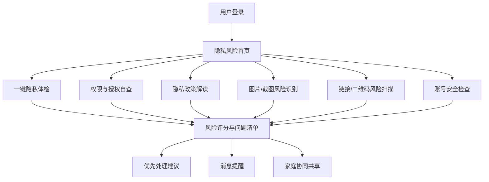
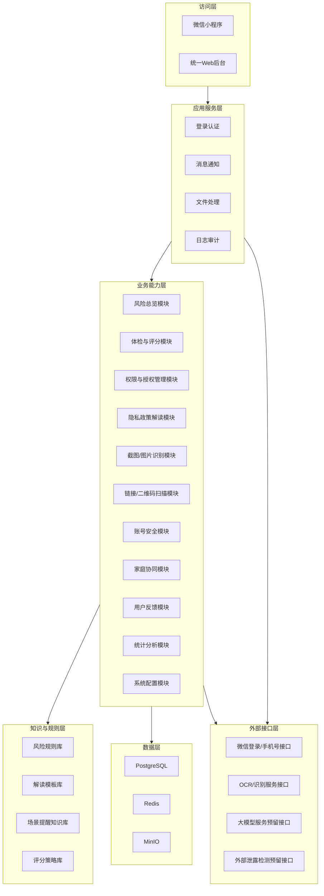
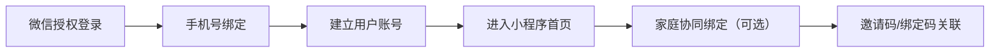
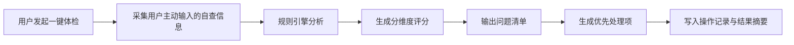
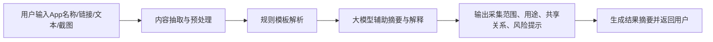
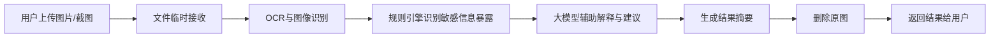
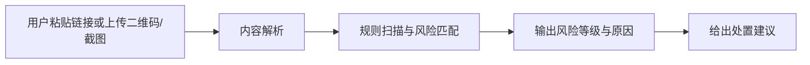
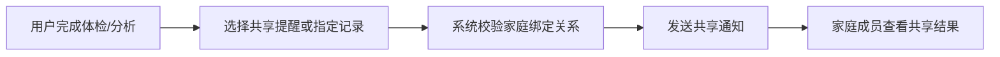
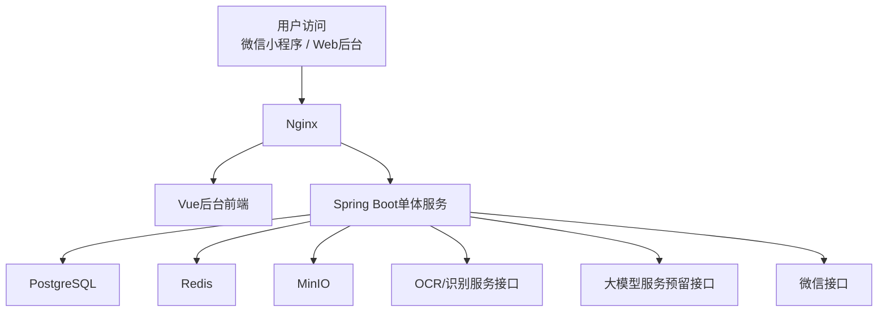

# 个人隐私数据安全管家系统架构设计说明书

版本：V1.0  
日期：2026-04-13  
文档类型：系统架构设计说明书  
适用对象：第三方开发公司、项目甲方、指导老师、比赛评审  
对应项目文档：个人隐私数据安全管家项目文档（甲方策划版）

---

## 一、文档说明

### 1.1 编写目的

本文档用于从系统实现角度，对“个人隐私数据安全管家”进行整体架构设计说明，明确系统建设范围、业务主线、功能分层、技术选型、数据边界、部署结构和安全策略，为第三方开发公司提供可执行的总体设计依据。

### 1.2 文档定位

本文档属于“系统架构文档”，重点回答以下问题：

1. 系统服务哪些角色，核心业务链路如何构成。
2. 系统采用何种终端组合和总体架构模式。
3. 系统如何划分前端、小程序、后台与后端能力边界。
4. 系统如何处理本地优先、最小必要、截图分析、风险识别和知识解释等关键问题。
5. 系统如何保障数据安全、权限隔离和后续扩展能力。

### 1.3 文档边界

本文档聚焦系统架构层面设计，包含：

- 系统角色与终端架构
- 核心业务场景与流程
- 模块划分与分层结构
- 数据架构与数据边界
- 技术架构与部署架构
- 权限、安全、日志、存储与扩展设计

本文档不展开到：

- 按钮级页面说明
- 各端功能点清单表
- 详细数据库字段设计
- 完整接口字段协议

### 1.4 设计依据

本架构设计依据如下：

1. 已完成的《个人隐私数据安全管家项目文档》中的产品定位、用户痛点、场景定义和项目边界。
2. 甲方已确认的建设策略：完整平台规划，一期以MVP落地为主。
3. 甲方已确认的产品形态：`微信小程序 + Web后台`，原生App和浏览器插件作为二期预留。
4. 甲方已确认的数据原则：本地优先处理、最小必要采集、原图分析后立即删除、只保留结果摘要。
5. 甲方已确认的技术路线：`Vue + Spring Boot + PostgreSQL + Redis + MinIO + Nginx`，采用前后端分离、单体后端、模块化可扩展架构。

---

## 二、项目建设目标与系统范围

### 2.1 总体建设目标

本系统的总体建设目标是：围绕个人隐私数据保护场景，构建一个以用户主动自查、规则识别、风险解释、场景提醒和家庭协同为主线的隐私治理平台，帮助用户完成“看见风险、理解风险、处理风险、持续防护”的完整闭环。

### 2.2 系统目标

系统需实现以下核心目标：

1. 支撑个人隐私风险总览与风险评分。
2. 支撑用户主动提交的权限自查、截图上传识别、链接/二维码风险扫描和隐私政策解读。
3. 支撑账号安全检查、泄露风险提醒入口和风险体检报告输出。
4. 支撑家庭协同守护和风险记录共享。
5. 支撑后台规则库、知识库、解读模板和内容管理能力。
6. 支撑本地优先、云端最小化处理、安全留痕和后续扩展。

### 2.3 一期建设范围

本次架构设计按“完整平台能力”进行规划，但一期实施以MVP为主，优先保证“自查 + 解读 + 提醒 + 体检 + 协同”主链路打通。

一期纳入范围：

- 小程序登录与账号体系
- 隐私风险首页总览
- 一键隐私体检
- App权限与授权管理建议
- 隐私政策输入与解读
- 截图/图片上传识别与风险解释
- 可疑链接/二维码主动扫描
- 账号安全检查与泄露风险提醒入口
- 家庭协同绑定与结果共享
- 站内消息与订阅消息
- 后台规则配置、模板维护、反馈管理和数据看板

### 2.4 一期不纳入范围

为控制复杂度，一期不纳入以下内容：

- 系统级自动读取全部设备权限状态
- iOS/Android原生系统深度能力调用
- 浏览器插件正式实现
- 外部泄露检测平台深度对接
- 实时后台人工复核流程
- 企业/学校/社区合作版多租户正式交付

### 2.5 二期预留范围

系统需预留后续扩展能力，包括：

- 原生App增强版
- 浏览器插件
- 外部泄露检测接口
- 多租户/多机构合作版
- 更复杂的场景识别和设备侧安全能力
- 更强的家庭协同和账号资产管理能力

---

## 三、系统角色与终端架构

### 3.1 角色定义

系统共定义四类核心角色和一类预留角色：

| 角色 | 使用终端 | 核心职责 |
| --- | --- | --- |
| 普通用户 | 微信小程序 | 自查隐私风险、提交截图/链接/文本、查看体检报告和风险建议 |
| 家庭协同用户 | 微信小程序 | 绑定家庭成员、共享提醒、查看指定共享记录 |
| 运营/内容管理员 | Web后台 | 维护风险规则、知识内容、解读模板、通知与反馈 |
| 系统管理员 | Web后台 | 账号、角色、权限、审计、系统配置与数据管理 |
| 预留角色（合作机构） | Web后台预留 | 后续面向学校、社区、企业等合作场景扩展 |

### 3.2 终端形态

当前终端组合如下：

- 用户端：微信小程序
- 管理端：统一Web后台

二期预留：

- 原生App
- 浏览器插件

### 3.3 统一后台策略

后台不拆分为多个独立系统，而采用“统一后台 + 角色权限区分”的方式实现，便于控制开发复杂度、统一数据管理和维护规则配置。

---

## 四、业务架构与核心场景

### 4.1 业务主线

本系统围绕以下三条主线构建：

1. 用户主动隐私自查主线
2. 风险解释与行动建议主线
3. 家庭协同与持续提醒主线

### 4.2 核心业务场景

甲方已确认的一期核心业务场景如下：

1. 隐私风险总览
2. App权限与授权管理
3. 隐私政策智能解读
4. 账号安全与泄露风险提醒
5. 一键隐私体检
6. 场景化高风险提醒
7. 家庭协同守护

### 4.3 核心场景关系图

### 4.4 风险评分维度

系统统一按以下五个维度构建风险评分体系：

1. 权限风险
2. 账号安全风险
3. 隐私暴露风险
4. 诈骗与链接风险
5. 数据授权与政策风险

---

## 五、总体架构设计

### 5.1 架构设计原则

系统架构遵循以下原则：

1. 本地优先原则：能在本地完成的判断尽量在本地完成。
2. 最小必要原则：仅采集实现业务所必须的数据。
3. 主动触发原则：一期所有高敏感检测能力均以用户主动发起为前提。
4. 解释优先原则：风险识别后必须给出通俗解释和处理建议。
5. 单体稳妥原则：一期采用单体后端降低开发和运维复杂度。
6. 模块扩展原则：在单体基础上按业务域模块化，为后续原生App、浏览器插件和多租户扩展预留空间。
7. 安全可追踪原则：所有敏感流程要有权限控制、日志留痕和数据生命周期约束。

### 5.2 总体分层架构

系统采用“访问层 + 应用服务层 + 业务能力层 + 知识与规则层 + 数据层 + 外部接口层”的总体架构。

### 5.3 架构形态说明

1. 小程序端面向用户和家庭协同用户。
2. Web后台统一服务运营/内容管理员和系统管理员。
3. 后端采用单体应用，但内部按能力模块拆分。
4. OCR、模型解读、外部查询等能力通过统一适配层接入。
5. 风险判断以规则和知识库为主，大模型为辅助解释能力，不承担唯一判断责任。

---

## 六、终端架构设计

### 6.1 小程序端架构定位

小程序端是用户进行隐私治理的核心入口，主要承担：

- 登录与身份绑定
- 风险总览展示
- 自查任务发起
- 检测结果查看
- 风险提醒接收
- 家庭协同共享
- 用户操作记录查看

### 6.2 小程序一级栏目

甲方已确认的小程序一级栏目如下：

- 首页
- 体检
- 风险
- 解读
- 消息
- 我的

### 6.3 小程序能力边界

鉴于当前产品形态为微信小程序，一期不依赖系统级自动采集能力，因此以下能力均采用“用户主动触发”的模式实现：

- 用户手动自查
- 用户主动粘贴文本/链接
- 用户主动上传截图/图片
- 系统输出风险评分与建议

### 6.4 Web后台架构定位

统一后台主要承担以下职责：

- 用户与账号管理
- 风险规则配置
- 内容与知识库管理
- 隐私政策解读模板维护
- 用户反馈与事件管理
- 数据统计看板
- 系统配置与审计管理

### 6.5 后台角色权限策略

统一后台按角色区分菜单和权限：

- 运营/内容管理员：规则、模板、知识、通知、反馈、统计
- 系统管理员：账号、角色、权限、日志、系统配置
- 预留合作机构角色：后续拓展

---

## 七、后端模块化架构设计

### 7.1 模块划分原则

后端虽然采用单体架构，但必须按业务域清晰拆分，避免形成后期难以维护的耦合式系统。

### 7.2 建议模块划分

| 模块名称 | 模块职责 |
| --- | --- |
| `auth-center` | 微信登录、手机号绑定、后台登录、Token管理、角色鉴权 |
| `user-center` | 用户账号、家庭绑定、个人资料、游客模式控制 |
| `risk-dashboard` | 风险总览、首页聚合、风险摘要输出 |
| `health-check` | 一键隐私体检、分维度评分、问题清单、优先处理项 |
| `permission-check` | 权限自查信息接收、权限风险识别、权限建议生成 |
| `policy-interpret` | App名称/链接/文本/截图输入、隐私政策解析、解读结果输出 |
| `image-risk-analyze` | 图片/截图OCR、敏感信息识别、场景化风险解释 |
| `link-risk-analyze` | 链接与二维码识别、规则扫描、风险提醒 |
| `account-security` | 账号清单、弱密码/重复密码风险提示、泄露提醒入口 |
| `family-guard` | 家庭关系绑定、提醒共享、指定记录共享 |
| `message-center` | 站内消息、订阅消息、发送记录 |
| `feedback-center` | 问题反馈、误报反馈、建议反馈、申诉反馈 |
| `rule-engine` | 风险规则库加载、评分计算、规则执行 |
| `knowledge-center` | 场景提醒知识库、科普内容、解释建议模板 |
| `template-center` | 隐私政策解读模板、大模型提示模板、通知模板 |
| `file-center` | 文件上传、OCR输入文件临时管理、结果摘要关联 |
| `analytics-center` | 注册、活跃、体检、风险、反馈、协同等统计分析 |
| `audit-log` | 登录日志、操作日志、敏感操作记录、消息日志 |
| `system-config` | 字典、系统参数、租户预留字段、开关配置 |

### 7.3 模块依赖原则

1. 所有业务模块统一依赖认证与权限模块。
2. 规则识别与风险评分统一依赖规则引擎和知识库。
3. 模型调用统一通过外部接口适配层接入，不允许业务模块直接硬编码调用。
4. 文件和截图输入统一走文件中心，不允许各模块自行处理原始文件生命周期。
5. 所有通知统一走消息中心，不允许业务模块直接调用微信通知接口。

---

## 八、关键业务流程设计

### 8.1 用户登录与家庭绑定流程

### 8.2 一键隐私体检流程

### 8.3 隐私政策解读流程

### 8.4 图片/截图风险识别流程

### 8.5 链接/二维码扫描流程

### 8.6 家庭协同共享流程

---

## 九、数据架构设计

### 9.1 数据架构目标

数据架构需支撑以下目标：

1. 支撑用户账号与家庭协同关系。
2. 支撑风险检测与结果摘要的留存。
3. 支撑规则、模板、知识库的可配置化管理。
4. 支撑用户反馈、消息、统计和审计。
5. 支撑最小必要采集与原图即时删除策略。

### 9.2 核心数据对象

| 数据对象 | 说明 |
| --- | --- |
| 用户账号 | 账号基础信息、手机号、微信标识、状态 |
| 家庭绑定关系 | 家庭成员关系、绑定码、共享权限 |
| 体检记录 | 体检时间、分维度得分、总分、问题清单、优先处理项 |
| 权限自查记录 | 用户主动提交的权限信息摘要和分析结果 |
| 政策解读记录 | 输入类型、解读摘要、风险说明、建议结果 |
| 图片识别结果 | 敏感信息类型、风险等级、解释说明、建议结果 |
| 链接扫描结果 | 风险类型、风险等级、规则命中结果 |
| 账号安全记录 | 账号清单、风险提示、泄露查询入口使用记录 |
| 风险规则 | 风险识别条件、权重、等级阈值 |
| 评分策略 | 各维度评分模型与权重配置 |
| 解读模板 | 隐私政策解读模板和提示模板 |
| 场景知识库 | 场景风险说明、建议话术、提醒模板 |
| 用户反馈 | 问题反馈、误报、建议、申诉 |
| 消息记录 | 站内消息、订阅消息发送记录 |
| 操作记录 | 用户体检、上传、共享等行为记录 |
| 日志审计 | 登录、操作、敏感动作、消息发送日志 |

### 9.3 数据处理边界

甲方已确认的数据边界如下：

允许采集的数据包括：

- 基础账号信息
- 用户主动授权的应用权限信息摘要
- 用户主动提交的风险体检结果
- 用户主动上传的截图/图片输入
- 家庭协同绑定关系

不采集或不长期保存的内容包括：

- 用户密码明文或密文
- 未经用户主动触发的系统级持续监控数据
- 原始上传图片长期留存

### 9.4 原图处理策略

对于用户主动上传的截图或图片，系统采用以下策略：

1. 文件临时接收用于识别分析。
2. 完成OCR和规则分析后立即删除原始文件。
3. 仅保留结果摘要、风险标签、解释文本和必要元数据。

这是本系统数据架构中的关键隐私保护策略。

### 9.5 数据模型扩展策略

一期采用单租户实现，但数据模型需预留以下字段或结构：

- `tenant_id`
- `org_id`

用于支持未来合作机构、学校、社区、企业版等多组织扩展能力。

---

## 十、知识与规则架构设计

### 10.1 风险规则库

风险规则库负责定义和管理：

- 权限风险判断规则
- 图片/截图敏感信息识别规则
- 链接/二维码风险匹配规则
- 体检评分权重规则
- 风险等级映射规则

### 10.2 解读模板库

解读模板库负责维护：

- 隐私政策通用解读模板
- 常见采集项说明模板
- 第三方共享解释模板
- 风险解释输出模板
- 大模型提示模板

### 10.3 场景提醒知识库

场景提醒知识库负责维护以下内容：

- 社交平台敏感信息暴露场景
- 快递单/证件照/截图外露场景
- 高敏权限长期开放场景
- 公共Wi-Fi风险操作场景
- 可疑链接/二维码场景
- AI换脸与拟声诈骗提醒内容

### 10.4 规则与模型协同策略

本系统采用“规则主导、模型辅助”的协同方式：

1. 风险判定以规则和知识库为主，保证可解释和可控。
2. 大模型主要用于文本摘要、解释增强和建议优化。
3. 系统不将大模型作为唯一风险判断依据。

---

## 十一、技术架构设计

### 11.1 技术选型

| 层级 | 技术选型 | 说明 |
| --- | --- | --- |
| 用户端 | 微信小程序 | 一期用户访问主入口 |
| 后台前端 | Vue | 统一后台管理系统 |
| 反向代理 | Nginx | 统一入口与静态资源代理 |
| 后端服务 | Spring Boot | 单体后端主服务 |
| 数据库 | PostgreSQL | 业务主数据与规则配置存储 |
| 缓存 | Redis | 会话、热点数据、任务状态缓存 |
| 对象存储 | MinIO | 临时文件与部分可保留附件对象存储 |

### 11.2 技术路线说明

1. 一期统一采用 Spring Boot 实现业务后端，避免多语言栈带来额外维护成本。
2. 后台采用 Vue 统一实现内容配置、规则管理和统计分析。
3. 小程序端与后台端通过统一REST接口访问后端服务。
4. OCR、模型解读和外部泄露查询采用外部接口适配层方式接入。

### 11.3 前后端交互方式

1. 小程序与后台统一通过 RESTful API 调用业务服务。
2. 文件上传采用专用上传接口，分析结果通过异步任务回写。
3. 所有接口采用统一鉴权、统一返回结构和统一错误码规范。

### 11.4 异步任务处理策略

OCR、截图识别、二维码扫描、隐私政策摘要等任务采用：

`同步提交 + 异步分析 + 结果回写`

这样设计的优势是：

1. 降低前端等待时间。
2. 适配OCR和模型调用的处理延迟。
3. 便于任务状态跟踪、失败重试和日志记录。

### 11.5 外部模型接口策略

大模型能力采用“外部大模型服务接口预留，模型厂商可替换”的方式实现。

调用范围包括：

- 隐私政策摘要与风险解释
- 截图内容解释
- 场景化建议生成

但核心规则判断仍由本地规则引擎负责。

### 11.6 外部泄露检测接口策略

一期仅提供“疑似泄露风险提醒入口”和预留接口，不正式接入第三方泄露查询服务。后续可扩展对接外部平台。

---

## 十二、后台系统架构设计

### 12.1 后台核心能力

后台统一承载以下能力：

1. 用户与账号管理
2. 风险规则配置
3. 内容与知识库管理
4. 隐私政策解读模板维护
5. 用户反馈与事件管理
6. 数据统计看板
7. 审计与系统配置

### 12.2 后台功能分区

建议后台划分为以下功能分区：

- 用户中心
- 规则中心
- 模板中心
- 知识中心
- 反馈中心
- 消息中心
- 数据分析中心
- 日志审计中心
- 系统配置中心

### 12.3 后台配置化原则

甲方已确认以下内容需通过后台可配置，不应依赖改代码更新：

- 风险规则库
- 解读模板库
- 场景提醒知识库
- 通知内容模板

---

## 十三、安全架构设计

### 13.1 安全目标

系统需满足以下安全目标：

1. 用户隐私数据最小化采集。
2. 用户主动上传内容的生命周期受控。
3. 家庭协同共享边界明确。
4. 管理后台权限隔离清晰。
5. 关键行为可审计、可追溯。

### 13.2 权限模型

系统采用“用户 - 角色 - 权限 - 组织预留”的RBAC模型。

主要权限维度包括：

- 菜单权限
- 接口权限
- 数据权限
- 内容配置权限
- 审计查看权限

### 13.3 隐私保护原则

甲方已确认的核心隐私原则如下：

- 最小必要原则
- 用户明示授权
- 本地优先处理
- 敏感信息脱敏展示
- 可删除、可撤回、可导出

### 13.4 用户记录与共享边界

1. 家庭协同仅支持共享提醒和指定记录。
2. 家庭成员不具备代替对方进行系统级权限操作的能力。
3. 用户可查看自己的操作记录、检测记录和共享记录。

### 13.5 日志审计设计

系统应记录以下日志：

- 登录日志
- 用户操作日志
- 规则配置变更日志
- 模板与知识库变更日志
- 文件处理日志
- 消息发送日志
- 家庭协同共享日志

### 13.6 文件安全策略

1. 上传文件采用临时存储。
2. 文件仅用于识别分析任务。
3. 原图在分析后立即删除。
4. 保留的仅为结果摘要与元数据。

### 13.7 数据导出与删除

系统需预留以下能力：

- 用户结果摘要导出
- 用户记录删除
- 家庭关系解除
- 消息与反馈记录查询

---

## 十四、部署架构设计

### 14.1 当前部署目标

当前部署目标为：

1. 满足本地演示服务器和普通云服务器部署。
2. 满足1000注册用户、200日活、50家庭协同绑定、1个后台运营团队的初期运行规模。
3. 为未来迁移至政务云或企业云保留兼容性。

### 14.2 部署拓扑

### 14.3 部署方式建议

建议采用 Linux 服务器部署，一期可采用单机部署模式：

| 组件 | 部署方式 | 说明 |
| --- | --- | --- |
| Nginx | 单机部署 | 统一入口与反向代理 |
| Vue后台前端 | Nginx静态托管 | 后台管理系统 |
| Spring Boot服务 | 单实例部署 | 一期业务量可支撑 |
| PostgreSQL | 单实例部署 | 核心业务数据 |
| Redis | 单实例部署 | 缓存与任务状态 |
| MinIO | 单实例部署 | 临时文件存储 |

### 14.4 资源规模建议

建议演示环境资源按以下级别规划：

- 8 核 CPU
- 16GB 内存
- 200GB 存储

该配置可满足一期演示、试用和基础运营需求。

### 14.5 云环境迁移考虑

未来迁移至政务云或企业云环境时，应保留以下兼容性：

1. 各组件可容器化部署。
2. 数据模型支持多组织扩展。
3. 外部接口可替换。
4. 单体服务未来可按识别、分析、消息等能力拆分。

---

## 十五、非功能架构设计

### 15.1 性能目标

在当前用户规模下，系统性能目标建议如下：

1. 常规页面响应控制在3秒内。
2. 常规查询接口控制在1秒内。
3. 上传分析类任务采用异步回写，不以同步耗时作为页面阻塞点。
4. 体检结果生成需控制在可接受等待范围内，并支持状态提示。

### 15.2 可用性目标

1. 核心业务写库优先，外部接口失败不阻断主流程。
2. OCR、大模型等外部能力失败时，可降级为规则提示或稍后重试。
3. 任务失败需支持日志追踪与人工重试。

### 15.3 可解释性目标

本产品与一般系统最大的不同，在于必须保证输出结果“能解释”：

1. 每条高风险判断需给出原因。
2. 每个体检结果需给出问题清单和优先处理项。
3. 每个政策解读结果需输出通俗化说明。

### 15.4 可扩展性目标

1. 支持从小程序扩展到原生App。
2. 支持从单租户扩展到多组织模式。
3. 支持从规则解释扩展到更多AI辅助能力。
4. 支持外部泄露接口、插件端和更多识别能力扩展。

### 15.5 游客模式目标

系统支持部分游客体验能力：

- 静态知识内容浏览
- 部分政策解读体验

但以下能力必须登录后使用：

- 上传分析
- 体检记录
- 家庭协同
- 消息提醒

---

## 十六、统计分析架构设计

### 16.1 后台统计指标

甲方已确认后台重点统计指标包括：

- 注册用户数
- 日活/周活
- 体检次数
- 风险类型分布
- 高风险问题占比
- 用户反馈数量
- 家庭协同绑定数量

### 16.2 分析用途

这些指标主要用于：

1. 评估产品使用情况。
2. 判断高风险场景分布。
3. 优化规则和知识库内容。
4. 支撑项目展示和汇报。

---

## 十七、架构验收建议

从甲方和第三方沟通角度，建议重点验收以下内容：

1. 小程序与后台角色体系是否清晰。
2. 风险总览、体检、解读、截图分析、链接扫描是否形成完整链路。
3. 原图是否按要求分析后立即删除。
4. 风险评分是否支持五个维度和问题清单输出。
5. 家庭协同是否支持共享提醒和指定记录共享。
6. 后台是否支持规则、模板和知识库可配置。
7. 消息、日志、权限和统计能力是否具备。

---

## 十八、结语

本系统架构设计遵循“本地优先、规则主导、模型辅助、最小必要、持续治理”的原则，在兼顾展示性和可落地性的前提下，构建了一个适合第三方开发公司实施的隐私治理平台方案。

对于当前阶段而言，采用“微信小程序 + 统一Web后台 + Spring Boot单体服务 + 规则库/知识库支撑 + 外部能力预留接口”的总体架构，是最适合一期MVP落地、又能为后续原生App和插件扩展留下空间的方案。
